<p align="center">
  
</p>

<h3 align="center">From Phone Calls to Tracked IT Tickets</h3>

<p align="center">
  
  
  
  
  
  
  
  
</p>

Teqen (تِقَن) is a web-based IT ticket management system built during my IT internship at **Al Muzaylif General Hospital** (Mar–Aug 2025).

Before Teqen, hospital staff reported IT problems by phone, and requests were often missed when a call went unanswered. Teqen gives every department one place to submit an issue, and gives the IT team one dashboard to receive, track and close it.

## The Problem

- IT requests came in by **phone calls**, with no record of who asked for what.
- Calls were missed when the IT team was busy on another job, so **requests got lost**.
- There was no way to see **which departments had the most issues**, or how fast problems were solved.

## Features

**For hospital staff**
- **Submit a ticket** with a title, description, urgency level (low, medium, high) and a photo of the problem
- **Track my tickets** and see their status: New → In Progress → Resolved
- **Chat with IT** inside each ticket, with unread message indicators
- **Help page** with answers to common questions

**For the IT team**
- **Live dashboard** of open tickets that checks for new ones every 10 seconds and plays an **alert sound**
- **Take a ticket** (marks it In Progress with the employee's name), then **mark it resolved**
- **Reports page** with charts of tickets by department and the most common issues, filtered by year, month and department
- **Archive** of resolved tickets with search and filters

**For everyone**
- **Arabic and English** interface, switchable at any time
- **Secure accounts:** hashed passwords and password reset by email
- **Two roles:** normal staff and IT staff, each with their own pages

## Screenshots

*Screens from the running system (shown here in Arabic; the interface can be switched to English). User names are hidden.*

### Sign up and account access

<table>
  <tr>
    <td align="center">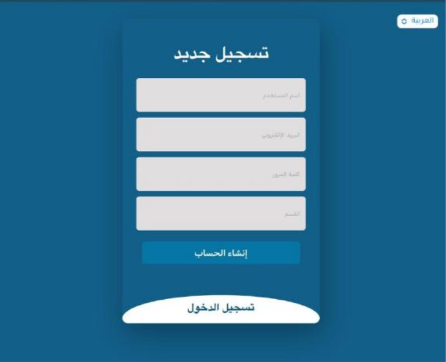<br><sub>Registration</sub></td>
    <td align="center">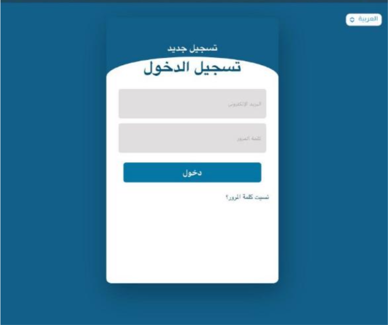<br><sub>Login</sub></td>
  </tr>
  <tr>
    <td align="center">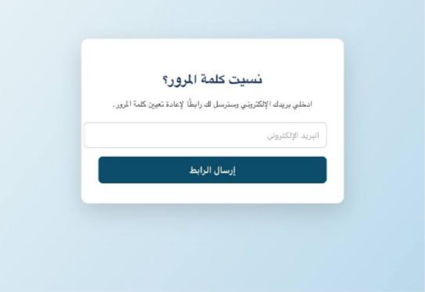<br><sub>Forgot password</sub></td>
    <td align="center">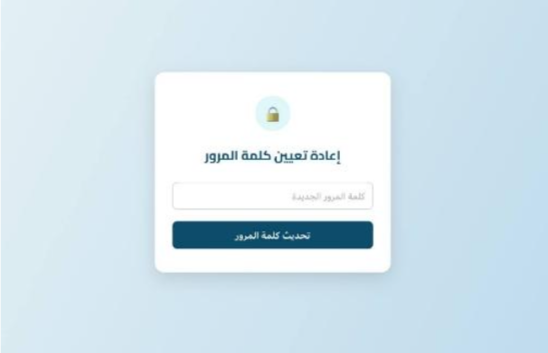<br><sub>Reset password</sub></td>
  </tr>
</table>

### IT team

<table>
  <tr>
    <td align="center">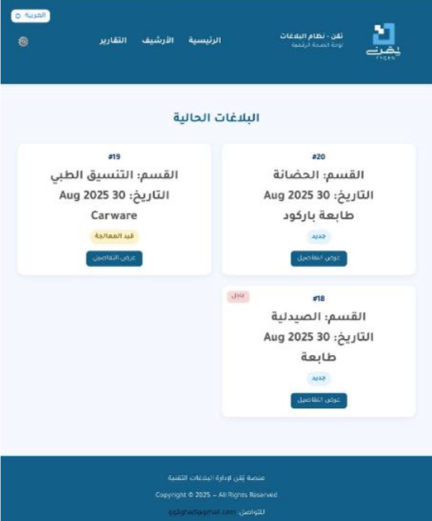<br><sub>Current tickets</sub></td>
    <td align="center">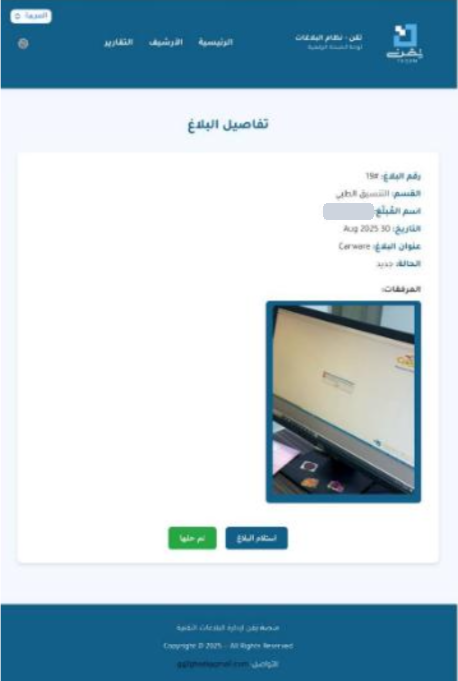<br><sub>Ticket details</sub></td>
  </tr>
  <tr>
    <td align="center">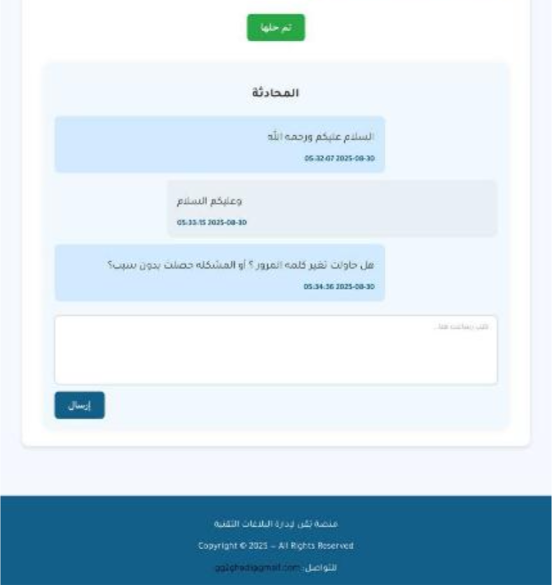<br><sub>Chat inside a ticket</sub></td>
    <td align="center">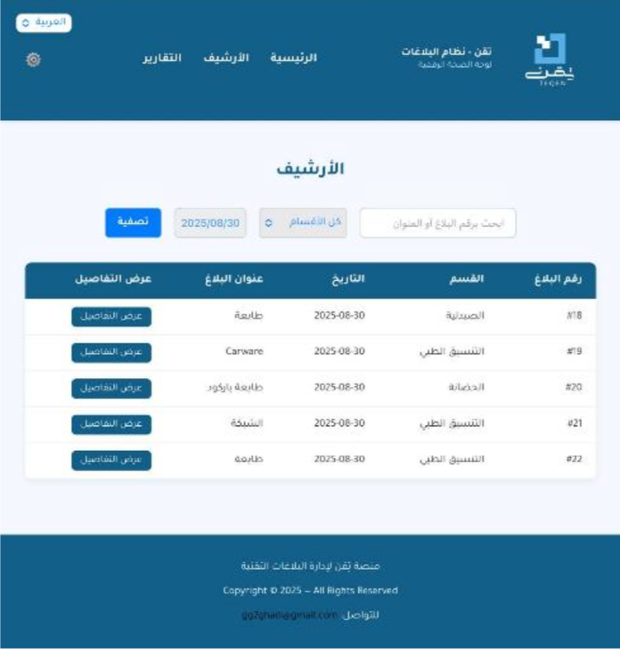<br><sub>Archive</sub></td>
  </tr>
  <tr>
    <td align="center">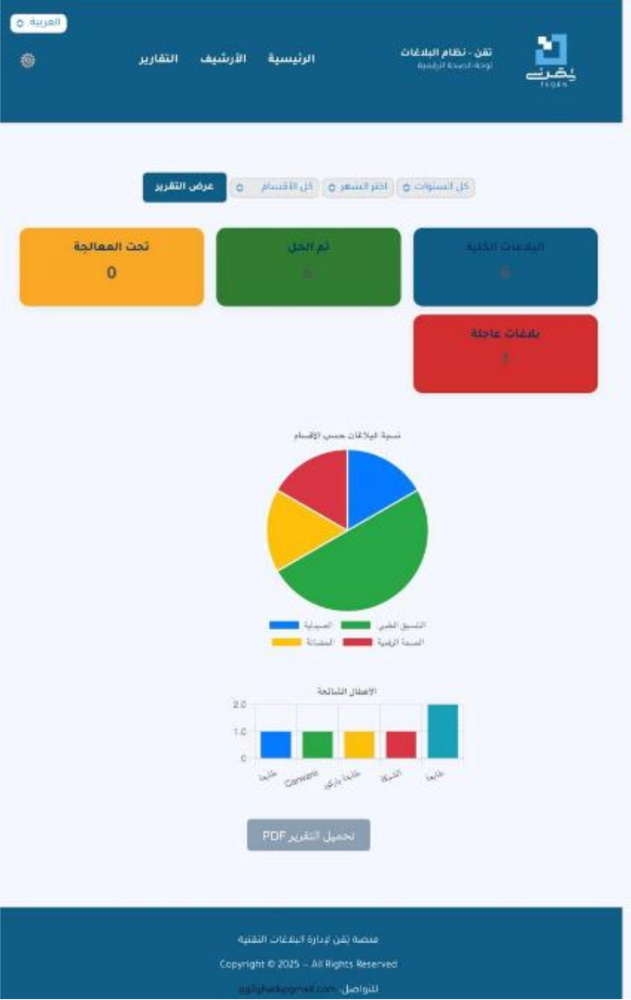<br><sub>Reports and charts</sub></td>
    <td align="center">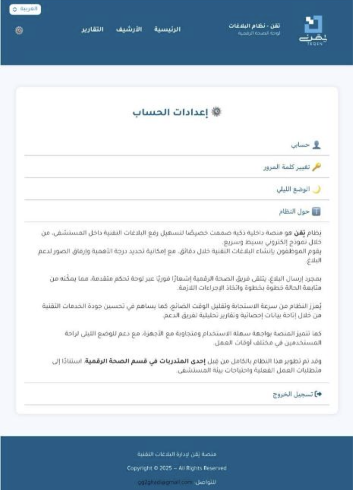<br><sub>Account settings</sub></td>
  </tr>
</table>

### Hospital staff

<table>
  <tr>
    <td align="center">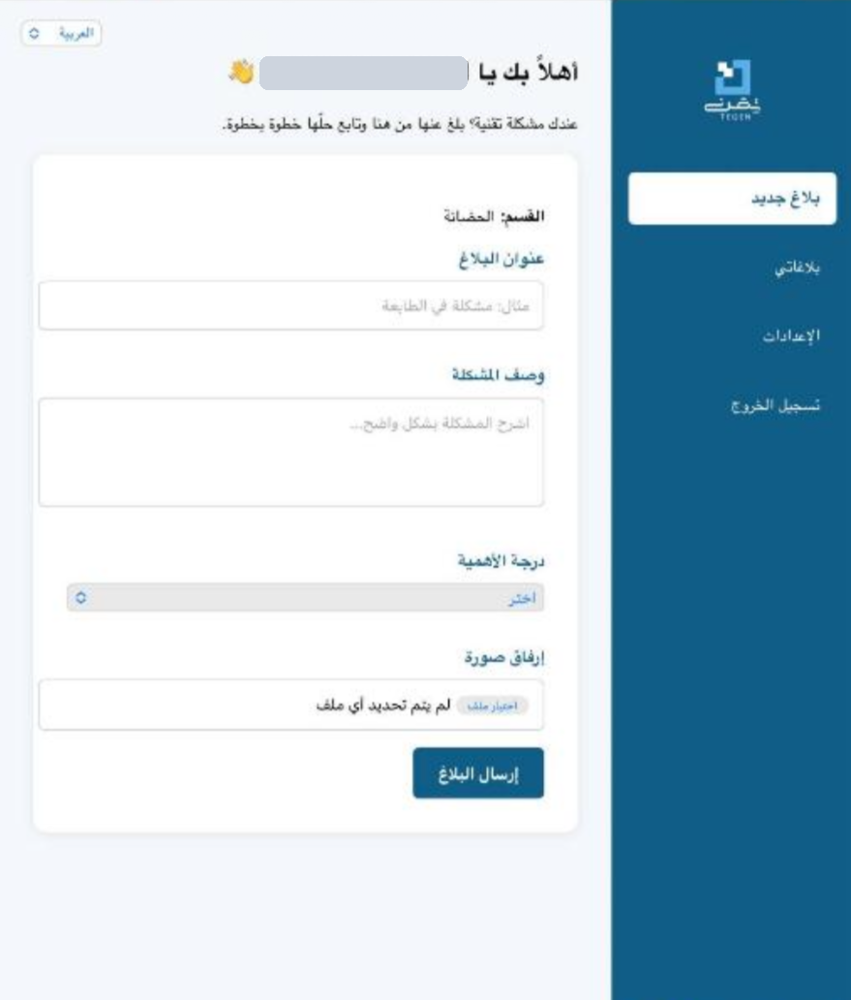<br><sub>New ticket</sub></td>
    <td align="center">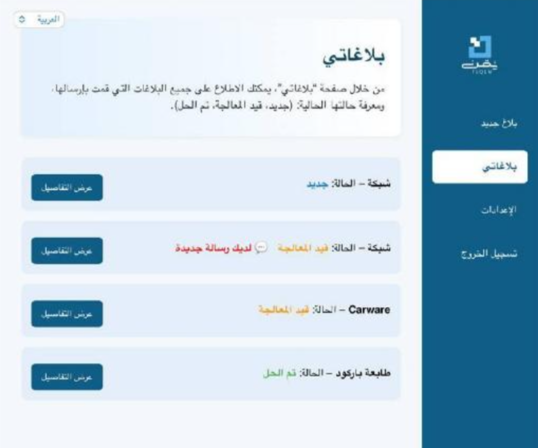<br><sub>My tickets</sub></td>
  </tr>
  <tr>
    <td align="center" colspan="2">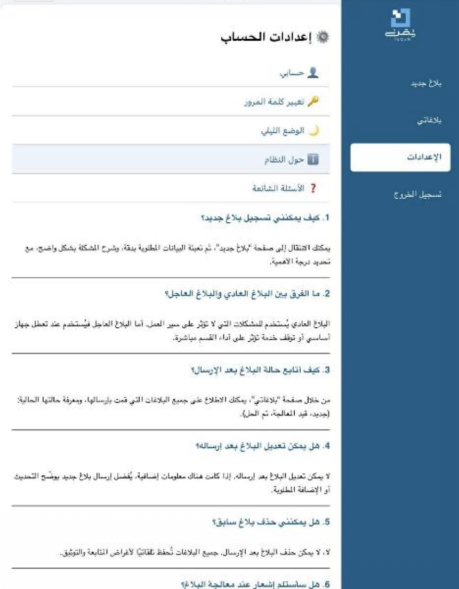<br><sub>Settings and help</sub></td>
  </tr>
</table>

## How It Works

1. A staff member signs up with their department and submits a ticket.
2. The IT dashboard shows it instantly with a sound alert.
3. An IT employee takes the ticket, and can message the staff member to troubleshoot remotely.
4. When it is fixed, the ticket is marked resolved and moves to the archive.
5. The reports page turns all tickets into charts, so the team can see where problems happen most.

## Project Structure

```
Teqen/
├─ index.php              Login and sign up
├─ forgot_password.php    Send a password reset link by email
├─ reset_password.php     Set a new password
│
├─ new_report_form.php    Staff: submit a ticket
├─ submit_report.php      Staff: save the ticket and photo
├─ userreports.php        Staff: my tickets
├─ user_details.php       Staff: ticket details and chat
├─ usersettings.php       Staff: account settings
│
├─ Home.php               IT: live dashboard of open tickets
├─ fetch_reports.php      IT: counts open tickets for the live alert
├─ Details.php            IT: ticket details, take / resolve, chat
├─ Reports.php            IT: charts and statistics
├─ Archive.php            IT: resolved tickets
├─ settings.php           IT: account settings
│
├─ send_message.php       Saves chat messages
├─ lang.php               Arabic and English text
├─ db.php                 Database connection
├─ config.example.php     Settings template (copy to config.php)
├─ database.sql           Database tables
├─ PHPMailer.php, SMTP.php, Exception.php   Email library
├─ style.css, Estyle.css  Styles
├─ alert.mp3              New ticket sound
├─ logo.png
└─ assets/                README images
```

## Author

**Ghadi Alrashdi** · [LinkedIn](https://www.linkedin.com/in/ghadi-alrashdi-431a67276) · [GitHub](https://github.com/Ghadi213)

Built during an IT internship at Al Muzaylif General Hospital (2025).
